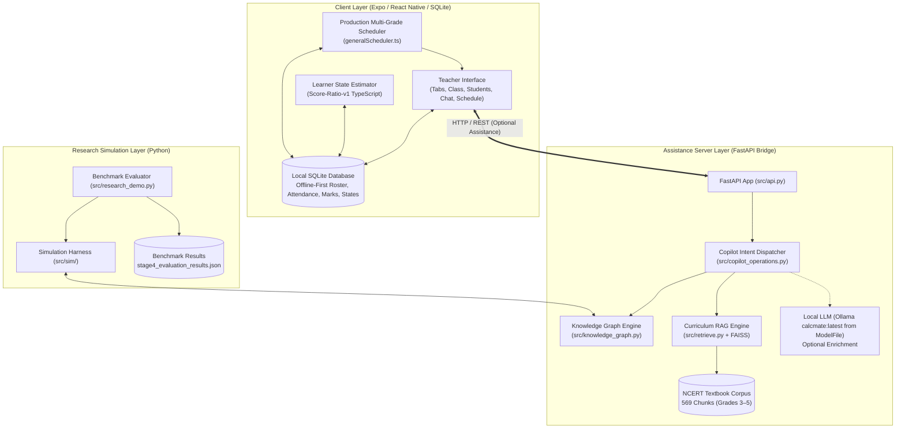
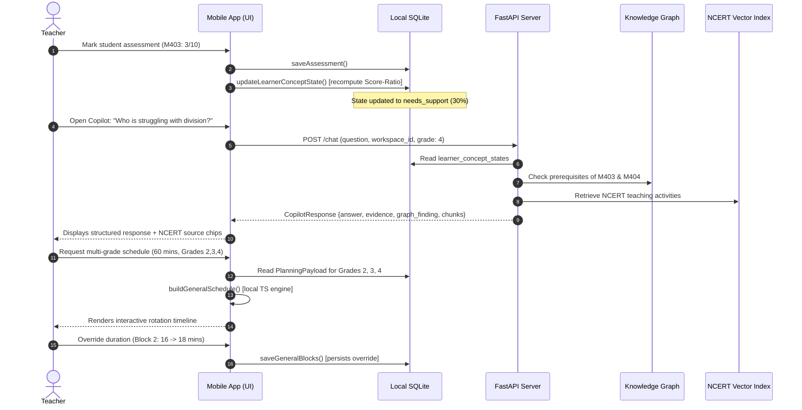

# CALCMATE — System Architecture and Technical Specifications
## End-to-End Architectural Blueprint

**Project**: CALCMATE — Curriculum- and Knowledge-State-Aware Instructional Attention Allocation for Multi-Grade Classrooms  
**Scope**: Complete System Specification for Review Three Delivery  

---

## 1. High-Level Architectural Topology

CALCMATE is designed around an **offline-first client, edge-assisted intelligence** model tailored for resource-constrained primary schools.

---

## 2. Layer Specifications

### Layer 1: Client Application (Expo / React Native)
- **Framework**: React Native 0.76.7 / Expo SDK 52 with Expo Router.
- **Platforms**: Android (Primary deployment target), Web (Demonstration & review target).
- **Core User Journeys**:
  - `(tabs)/index.tsx`: Daily classroom overview, attendance completion status, urgent learning gaps, quick schedule access.
  - `(tabs)/students.tsx` & `students/[id].tsx`: Multi-grade roster management, individual concept mastery cards, prerequisite gap alerts, mark entry.
  - `(tabs)/assistant.tsx` & `chatbot.tsx`: Interactive teacher copilot with context injection, intent chip badges, and source attribution.
  - `general-schedule/[id].tsx` & `new.tsx`: Multi-grade instructional schedule generation, interactive timeline editor, and teacher overrides.

### Layer 2: Client Persistence (Local SQLite)
- **Engine**: `expo-sqlite` (Android) / `node:sqlite` (Test automation harness).
- **Key Schemas**:
  - `students`: `(id, workspace_id, name, grade, roll_number, is_active, ...)`
  - `attendance`: `(id, workspace_id, student_id, date, status, updated_at)`
  - `assessments`: `(id, workspace_id, student_id, concept_id, score, maximum, date, ...)`
  - `learner_concept_states`: `(id, workspace_id, student_id, concept_id, mastery_estimate, state_status, evidence_sufficiency, ...)`
  - `concepts`: `(id, workspace_id, title, grade, prerequisite_id, ...)`
  - `concept_prerequisites`: `(workspace_id, concept_id, prerequisite_id, relationship_type, confidence)`
  - `schedules`: `(id, workspace_id, teacher_id, data, created_at, updated_at)`

### Layer 3: Backend Bridge & Service Routers (FastAPI)
- **Entrypoint**: `src/api.py` combining:
  - `src/rag_api.py`: Base FastAPI application, `/health`, and `/chat` endpoint.
  - `src/learner_api.py`: `/learner/prerequisite-analysis`, `/learner/student-view`, `/learner/group-summary`.
  - `src/auth_api.py` & `src/admin_api.py`: Secure teacher accounts, token revocation, and administrator approval workflows.

### Layer 4: Copilot Intent Routing Pipeline
- **Intent Extractor** (`src/intent_extractor.py`): Deterministic keyword and alias matching supplemented by parameter extractors. Extracts `concept_id`, `grade`, `student_id`.
- **Dispatcher** (`src/copilot_operations.py`): Maps 11 intents to discrete operation handlers:
  - `op_find_students_by_concept`
  - `op_get_student_concept_state`
  - `op_get_student_progress`
  - `op_explain_prerequisites`
  - `op_explain_learning_difficulty`
  - `op_classroom_learning_summary`
  - `op_group_prerequisite_readiness`
  - `op_recommend_curriculum_activity`
  - `op_retrieve_ncert_resource`
  - `op_explain_concept`
  - `op_generate_instructional_schedule` (emits structured `invoke_local_scheduler` action signal)
  - `op_general_question` (general textbook question handling with retrieval fallback)
- **Response Composers** (`src/response_composer.py`):
  - `compose_deterministic`: Assembles structured facts, findings, and textbook excerpts without LLM dependencies.
  - `compose_with_llm`: Rephrases structured findings using local Ollama (`calcmate:latest` from `ModelFile`) while strictly preventing hallucination of factual numbers or names.

### Layer 5: Canonical Knowledge Graph
- **Graph Structure**: 84 concepts across Grades 1–5, 73 verified prerequisite edges.
- **Graph Algorithms** (`src/knowledge_graph.py`):
  - Topological sort & prerequisite chain resolution (`networkx.ancestors`).
  - Prerequisite readiness score:
    $$R(c, \mathbf{k}) = \prod_{p \in \text{Pred}(c)} k_p$$
  - Downstream dependency importance:
    $$I(c) = |\text{Descendants}(c)|$$

### Layer 6: Production Multi-Grade Scheduler
- **Engine**: `frontend/src/services/generalScheduler.ts` (1904 passing test cases).
- **Inputs**: Teacher time budget ($M \in [5, 480]$ min), active grades ($G \subseteq \{1, 2, 3, 4\}$), priority policy (`learning-needs` vs `balanced`), student attendance and assessment records.
- **Workflow**:
  1. Filters absent students out of attention calculations.
  2. Ranks concepts per grade by weak student count ($v < 0.60$) and unassessed counts.
  3. Traverses prerequisite links backward to prioritize foundational concepts when deficits exist.
  4. Topologically sorts grade urgency so weak prerequisite grades are taught before dependent grades.
  5. Computes sequential teacher-led rotation blocks with proportional durations.
  6. Assigns synchronized, differentiated activities for all concurrent unattended grades (e.g., peer practice, independent worksheets, partner check).
  7. Inserts opening number talks, transitions, and closing exit-ticket routines.

### Layer 7: Research Evaluation Simulator
- **Modules**: `src/sim/learners.py`, `src/sim/estimators.py`, `src/sim/stage4_evaluation.py`, `src/research_demo.py`.
- **Purpose**: Enables repeatable scientific benchmarking of CALCMATE vs Round-Robin, Static Timetable, and Needs-Only baselines across 5 scenarios and 5 seeds.

---

## 3. Communication Protocols and Data Flow

---

## 4. Security, Scoping, and Privacy

1. **Local Scoping**: Every database query is scoped strictly by `workspace_id` and `teacher_id`, preventing cross-teacher data leakage.
2. **Credential Safety**: Authentication tokens are stored in `expo-secure-store`; passwords are never logged or echoed back in validation errors.
3. **No Student Cloud Sync**: Student names, roll numbers, and assessment marks remain on the local school device. Only non-personally identifiable curriculum and RAG queries interact with the server bridge.

